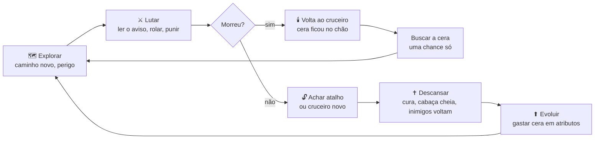
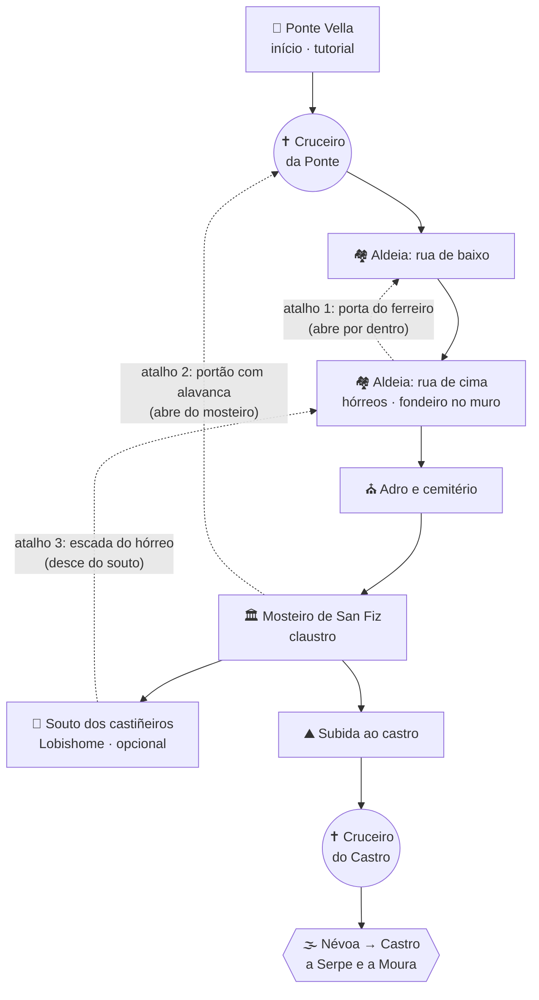

# Design do souls-like (01/11/2026)

> **Fase 1: documento de design.** Só documento: nenhum código. Os números são pontos de partida.
> Todos vão morar em `src/game/config/balance.js`, comentados em português.
> Nome provisório do jogo: "O Camiño das Ánimas". Antes da página da Steam, conferir se o nome está livre.

## Decisões do dono (01/11/2026)
| Tema | Decisão |
|---|---|
| Onde fica | Repositório próprio, `llr2ll/Souls_Like`. O survivor (`llr2ll/Zombie_Survivor`, antes `llr2ll/Game`) é só leitura: as peças são **copiadas** |
| Origem da cópia | Ponta da branch `j7b-classes`, commit `e4314ee` (31/10/2026). A `main` do survivor ainda não tem a fundação. Nesse commit, `npm run check` passa |
| Peças que dependem do mundo infinito | Copiar e mudar poucas linhas, tudo anotado em `docs/ORIGEM.md` (detalhes no fim da seção 9) |
| Câmera | De cima em 3/4, fixa, mais perto que a do survivor (seção 3.6) |
| Jogadores | Solo primeiro. Co-op local só depois da demo |
| Conceito | **A — O Camiño das Ánimas** (seção 1) |
| Moeda | Cera |
| Nome provisório | "O Camiño das Ánimas" |

---

## 1. Os três conceitos

### ✅ Conceito A — O Camiño das Ánimas (escolhido)

**Premissa.** Galiza, outono. Uma névoa desceu sobre o Caminho de Santiago e os mortos não descansam.
Romeiros que morreram no caminho se levantam e seguem andando, sem destino. Você é um peregrino ainda vivo.
Em cada cruceiro (cruz de pedra), você acende uma vela e carimba a credencial de peregrino.
A névoa respeita a luz da vela: ali dá para descansar.

**Objetivo.** Jogo completo: chegar a Compostela atravessando vales. Cada vale é uma área interligada,
com um chefe que fecha a passagem para o próximo. O caminho só liga um vale ao outro.
**Demo:** atravessar o Val de Santa Baia e vencer quem guarda o castro: a Serpe e a Moura.

**Por que cada pilar existe aqui**

| Pilar | Na história | Na mecânica |
|---|---|---|
| Cruceiro (ponto de descanso) | A vela acesa segura a névoa por um tempo | Cura, enche a cabaça, salva, sobe de nível |
| Inimigos renascem | Ao acender a vela, a névoa devolve os mortos ao caminho | Cada descanso é uma escolha: cura agora, mas o caminho enche de novo |
| Cabaça (frasco de cura) | A cabaça do peregrino, cheia na fonte do cruceiro | 4 goles. Recurso escasso entre um cruceiro e outro |
| Cera (moeda) | Os mortos derretem como vela quando caem. A cera é a oferenda do cruceiro | Sobe de nível. Fica no chão quando você morre |
| Morte com custo | Sua cera fica acesa no lugar onde caiu, como uma vela de defunto | Uma chance de voltar e pegar. Morreu antes, perdeu |
| Mundo interligado | Aldeias velhas: portas, portões, escadas de hórreo | Atalhos que abrem só de um lado |
| Chefes | Guardiões das passagens entre os vales | Névoa na entrada, 2 fases, música própria |
| História pelo mundo | Credenciais perdidas, inscrições nos cruceiros, cartas | Texto curto nos itens. Sem cutscene |

**Os 3 riscos e como contornar**
1. **O caminho virar corredor.** Caminho de Santiago é uma estrada: o risco é a área ficar reta.
   Por isso cada vale é um nó fechado e interligado (aldeia, igreja, mosteiro, mato, castro). A estrada só aparece entre os vales.
2. **Comparação com Blasphemous.** Ele também é espanhol e religioso, mas é 2D, andaluz e sangrento.
   Aqui o tom é outro: névoa, natureza e melancolia, folclore galego que mistura o pagão e o cristão. O inimigo é a névoa, não a fé.
3. **Tema religioso sensível.** Tratar com respeito, sem sátira. Igrejas e cruceiros são lugar de abrigo, nunca de vilão.

### Conceito B — O Castro das Mouras (não escolhido; fica de registro)
Um vale só, fechado, com um castro no meio servindo de centro (tudo volta a ele). Três mouras encantadas guardam três tesouros.
Cada uma vencida abre uma parte nova do vale. É o mais interligado dos três.
**Risco:** exige o level design do vale inteiro de uma vez. A demo mostraria 1/3 e pareceria incompleta.
**Peças que o A aproveita:** a moura e a serpe como chefe da demo.

### Conceito C — A Cruz da Compaña (não escolhido; fica de registro)
Você cruzou com a Santa Compaña e foi obrigado a carregar a cruz à frente da procissão. Para se livrar, precisa passá-la a outro.
Mecânica própria: a cada morte, uma alma a mais entra na fila atrás de você (velas visíveis), deixando você mais lento e mais visível.
Descansar num cruceiro solta uma alma.
**Riscos:** a morte foge do padrão souls (moeda no chão) e é uma mecânica sem prova. Repete o chefe do survivor.
**Peça que o A aproveita:** a vela como imagem da morte.

---

## 2. O laço principal



| Passo | O que acontece | O que o jogador sente |
|---|---|---|
| Explorar | Rua nova da aldeia, porta fechada, fondeiro no muro | Curiosidade com medo |
| Lutar | Cada inimigo avisa antes de bater. Errou a leitura, apanhou | Atenção total |
| Morrer | Tela escurece. A cera fica acesa onde caiu | "Foi culpa minha" (nunca "foi injusto") |
| Recuperar | Refazer o caminho, agora conhecido, até a vela | Tensão: tudo ou nada |
| Atalho | Uma porta que só abre por dentro devolve você ao cruceiro | Alívio e orgulho ("achei!") |
| Descansar | Cura e cabaça cheia, mas os mortos voltam | Respiro, com preço |
| Evoluir | Mais vida, mais fôlego, mais dano | Crescer devagar, por mérito |

---

## 3. Combate

### 3.1 O jogador
| O quê | Número | Observação |
|---|---|---|
| Vida | 100 | +6 por ponto de Vigor |
| Fôlego (stamina) | 100 | +4 por ponto de Alento |
| Recuperação do fôlego | 35/s depois de 0,5 s sem gastar | Bloqueando: 40% disso (14/s) |
| Andar | 4,4 m/s | Igual ao survivor |
| Correr (segurar rolar) | 6,6 m/s, gasta 15 de fôlego/s | Fôlego zerado: volta a andar |
| Andar bloqueando | 2,4 m/s | |
| Andar bebendo | 1,8 m/s | |
| Giro | Limitado, com aceleração | Já existe no movimento do survivor (`tune` do `balance.js`) |

### 3.2 Ataques (espada do peregrino, arma inicial)
| O quê | Leve (combo de 3) | Pesado |
|---|---|---|
| Fôlego | 12 por golpe | 24 |
| Duração | 0,38 / 0,38 / 0,52 s | ~0,9 s (preparação 0,45 · golpe 0,12 · recuperação 0,33) |
| Dano | 12 / 12 / 16 | 22 |
| Postura que tira do inimigo | 10 / 10 / 14 | 20 |
| Alcance · abertura | 2,4 m · ±60° (o 3º: ±35°, estocada) | 2,6 m · ±50° |
| Emendar | Janela de 0,8 s para o próximo golpe | — |

Regras que valem para todos os ataques:
- **Compromisso:** golpe começado não se cancela. Só o rolamento cancela, e só depois do impacto.
- **Buffer:** botão apertado até 0,25 s antes do fim do golpe fica guardado e sai na hora certa.
- **Para onde ataca:** sem alvo travado, para onde o stick esquerdo aponta no momento do aperto (parado: para a frente). Com alvo: no alvo.
- **Fôlego no fim:** dá para começar um golpe com qualquer fôlego acima de 0. O fôlego zera e a recuperação espera 0,5 s.
- **Dano só no quadro ativo** e só dentro do arco da arma.

### 3.3 Rolamento e defesa
| O quê | Número |
|---|---|
| Rolamento | 16 de fôlego · 0,55 s · invulnerável de 0,08 s a 0,38 s · ~3,5 m |
| Bloquear (escudo) | Segura 100% do dano físico. Gasta fôlego = dano × 1,5 |
| Guarda quebrada | Fôlego zerou bloqueando: 1,0 s atordoado, aberto a tudo |
| Aparar | 8 de fôlego · janela de 0,18 s · errou: fica aberto 0,5 s |
| Aparo certo | Inimigo comum: postura quebra na hora. Elite: +50% da barra. Chefe: +25% |
| Levar golpe comum | Tropeço de 0,35 s |
| Levar golpe forte (≥ 25 de dano ou marcado "forte") | Cai: 0,9 s no chão + levantar invulnerável por 0,4 s |

Base pronta no survivor: a investida do Samurai (0,22 s a 30 m/s, 0,35 s invulnerável) vira o molde do rolamento.

### 3.4 Postura e golpe crítico
- Cada inimigo tem uma **barra de postura**. Golpes enchem a barra. Ela esvazia sozinha (10/s) depois de 1,5 s sem levar golpe.
- **Inimigo comum (postura 30):** quebra com 3 leves seguidos (10 + 10 + 14) ou 1 pesado + 1 leve (20 + 10).
- **Postura quebrada:** o inimigo cai de joelhos e a arma brilha. Fica aberto por 2,0 s (elite 2,5 s, chefe 3,0 s).
- **Golpe crítico:** apertar o leve a até 2 m de quem está de joelhos. Causa 3× o dano do leve (espada: 36).
  Animação de 1,2 s, invulnerável. Inimigo caído no chão (sem estar de joelhos) leva +30%, como no survivor.

### 3.5 Inimigos: aviso e janela (regras de justiça)
- Todo golpe inimigo tem **aviso de no mínimo 0,4 s**: postura exagerada + som. Chefes: 0,5–0,9 s.
- Durante o aviso, o inimigo gira no máximo 180°/s. **No golpe, não gira mais.** Rolar para o lado sempre funciona.
- Depois de cada golpe, uma **janela para punir** (0,6–1,2 s, conforme o golpe).
- Golpe não atravessa parede. Inimigo não ataca de fora da tela sem aviso sonoro.
- Sem círculo vermelho no chão nos golpes comuns. Só nas áreas de golpe de chefe.
- Se o jogador morrer, ele precisa saber o porquê. Teste: perguntar "do que você morreu?" a quem testar.

### 3.6 Câmera e travar no alvo
| | Survivor hoje | Souls-like (início) |
|---|---|---|
| Inclinação | ~56° (altura 15, recuo 10) | ~50° (altura ~10, recuo ~8,4) |
| Distância | ~18 m | ~13 m |
| Campo de visão | 55° | 45° |
| Giro | Fixo | Fixo |

- Segue o jogador suave, com antecipação de ~1,5 m para onde ele anda.
- **Travar:** alcance 14 m. Solta sozinho a 18 m ou depois de 2 s sem ver o alvo. Com alvo, a câmera mantém os dois na tela e afasta até ~17 m (chefe: 18–20 m).
- Stick direito **não gira** a câmera: com alvo travado, troca de alvo.
- Paredes e telhados que tapam o jogador são recortados (o recorte das casas do survivor, com a inclinação da câmera nova).
- Tremor só no impacto, fraco.

### 3.7 Controles
| Ação | Controle (Xbox / PlayStation) | Teclado e mouse |
|---|---|---|
| Mover | Stick esquerdo | WASD |
| Leve | RB / R1 | Clique esquerdo |
| Pesado | RT / R2 | Shift + clique esquerdo |
| Rolar (segurar = correr) | B / ◯ | Espaço |
| Bloquear (segurar) | LB / L1 | Clique direito |
| Aparar | LT / L2 | Shift + clique direito |
| Travar no alvo | R3 (apertar o stick) | Q ou botão do meio |
| Trocar de alvo | Stick direito | Roda do mouse |
| Cabaça | X / ▢ | R |
| Usar (porta, alavanca, cruceiro) | A / ✕ | E |
| Trocar arma | Direcional ▶ | 1 / 2 / 3 |

Contrato de input: só **ganha** coisas. Ações novas em `game.act`: `light`, `heavy`, `roll`, `parry`, `lock`, `heal` (`use` e `swap` já existem no contrato copiado).
Bloquear e correr são de **segurar**: entram como campos novos no `setInput` (`guard`, e `run` já existe), sem mudar os que existem.

---

## 4. A área da demo: Val de Santa Baia

~25 min para quem joga pela primeira vez (caminho principal), +5 min com o Souto (opcional).
Tamanho aproximado: 180 × 140 m. Montada com casas, muros, árvores e água copiados do survivor.

### Ligações


### Planta (vista de cima, fora de escala)
```
                                   ↑ norte
            ┌──────────── CASTRO (chefe) ─────────────┐
            │  muralha redonda · 2 pallozas em ruína  │
            └────────────────────┬────────────────────┘
                            ░░ névoa ░░
                       ✝2 Cruceiro do Castro
                                 │  subida: 2 fondeiros, 2 romeiros
  ┌─────── SOUTO ────────┐  ┌────┴──── MOSTEIRO DE SAN FIZ ───────┐
  │ castanheiros         │  │ claustro · romeiros de hábito       │
  │ trasnos · LOBISHOME  ├──┤ alavanca do portão                  │
  │ maça de canteiro     │  └────────────────┬─────────────────┬──┘
  └─────────┬────────────┘                   │ portão          │
            ╎ atalho 3                       │ (atalho 2)      │
            ╎ (escada desce)                 │      ┌──────────┴─ ADRO E CEMITÉRIO ─┐
  ┌─────────┴─ ALDEIA: RUA DE CIMA ───────┐  │      │ romeiros nas covas            │
  │ hórreos · trasnos · fondeiro no muro  ├──┼──────┤ fondeiro na escada da igreja  │
  │ casa do ferreiro (andar de cima)      │  │      │ bordão ferrado                │
  └──┬─────────────┬──────────────────────┘  │      └───────────────────────────────┘
     │ volta longa ╎ atalho 1:               │
     │             ╎ porta do ferreiro       │
     │             ╎ (abre por dentro)       │
  ┌──┴─────────────┴─ ALDEIA: RUA DE BAIXO ┐ │
  │ romeiros ao lume · fonte               │ │
  └──────────────────┬─────────────────────┘ │
                     │                       │
            ✝1 Cruceiro da Ponte ◄───────────┘
                     │
            ════ PONTE VELLA ════   (rio; início)
```

### Zona por zona
| Zona | Tempo (1ª vez) | Inimigos | Itens e achados | O que ensina |
|---|---|---|---|---|
| Ponte Vella | 2–3 min | 2 romeiros (um de costas) | Inscrição na pedra: controles · 1 achado | Travar, ler o aviso, rolar, punir |
| ✝1 Cruceiro da Ponte | — | — | Credencial carimbada | Descansar renasce os inimigos |
| Aldeia, rua de baixo | 3 min | 3 romeiros sentados ao lume (emboscada) | Pan de millo · 1 achado | Vários de uma vez: puxar um por um |
| Aldeia, rua de cima | 4 min | 2 romeiros · 2 trasnos (um no hórreo) · 1 fondeiro no muro | **Anaco de cabaça** no andar de cima da casa do ferreiro | Subir escada, usar cobertura contra pedra |
| Atalho 1 | — | — | Descer da casa do ferreiro e abrir a porta por dentro | A 1ª recompensa por explorar |
| Adro e cemitério | 3 min | 3 romeiros saem das covas ao pegar o bordão · 1 fondeiro na escada da igreja | **Bordão ferrado** · Pan de millo · 1 achado | Item no meio da praça = armadilha |
| Mosteiro de San Fiz | 5 min | 4 romeiros de hábito no claustro | Concha de vieira · 2 achados | Lutar em corredor, porta como gargalo |
| Atalho 2 | — | — | Alavanca no claustro abre o portão até o ✝1 | O grande "achei!" da demo |
| Souto (opcional) | 5 min | 3 trasnos · **Lobishome** | **Maça de canteiro** · 400 de cera · 1 achado · escada do atalho 3 | Elite: aprender um padrão longo |
| Subida ao castro | 2 min | 2 fondeiros no alto · 2 romeiros | Concha de vieira · Pan de millo | Avançar sob pedras |
| ✝2 Cruceiro do Castro | — | — | — | Volta ao chefe curta (~20 s) |
| Castro (chefe) | 3–6 min por tentativa | A Serpe → a Moura | Fim da demo | Tudo junto |

Total no caminho principal: 22 inimigos comuns (16 romeiros, 2 trasnos, 4 fondeiros) e o chefe. O Souto soma 3 trasnos e o Lobishome.
Bem abaixo dos 55 bonecos ao mesmo tempo que o survivor aguenta.

---

## 5. Inimigos

### Comuns
| Inimigo | Vida · postura · dano | Golpes e aviso | Janela para punir | Como vencer |
|---|---|---|---|---|
| 🚶 **Romeiro perdido** (peregrino morto; monge no mosteiro) | 55 · 30 · 15 | **Pancada:** ergue o bordão acima da cabeça (0,5 s, gemido) e desce. **Dois cortes:** recolhe a foice para trás (0,45 s) e corta 2 vezes | 0,8 s depois da pancada; 1,0 s depois do 2º corte | Rolar para o lado na descida e punir com 2 leves. Puxar um por vez |
| 👺 **Trasno** (diabinho do folclore, gorro vermelho) | 20 · 12 · 8 | **Salto:** agacha e dá uma risadinha (0,4 s), pula 5 m. Anda em 2–3. Pegou você: rouba 10% da cera e foge | 0,7 s preso no chão depois do salto | Rolar o salto e bater na aterrissagem. Matar o ladrão devolve a cera |
| 🪨 **Fondeiro** (atirador de funda) | 30 · 15 · 12 | **Pedra:** gira a funda com zunido que sobe (0,7 s) e atira (pedra a 18 m/s; dá para bloquear ou rolar). Uma pedra a cada 2,5 s. De perto: chute (0,4 s) e foge | 1,2 s depois do chute | Chegar perto pela cobertura. Escudo erguido segura a pedra |

Todos usam o humanoide do survivor (12 variações), com arma na mão e poses de aviso exageradas.
O trasno é o mesmo boneco em escala 0,55 e com cabeça própria. IA: patrulha → alerta → aproximar → aviso → golpe → recuo.

### Elite
| | |
|---|---|
| 🐺 **Lobishome** | Homem-lobo do souto. Vida 220 · postura 90 · não renasce |
| **Zarpaço duplo** | Puxa os braços para trás (0,45 s, rosnado) e dá 2 garradas de 18. Janela: 0,9 s |
| **Salto** | Agacha (0,6 s, uivo curto) e salta 7 m. Dano 28 (forte: derruba). Janela: 1,0 s depois de cair |
| **Uivo** | Para e uiva (1,0 s): chama 2 trasnos uma vez por luta. É a melhor hora para bater |
| Como vencer | Ficar a meia distância força o salto: rolar e punir. Aparar o zarpaço quebra metade da postura |
| Prêmio | Maça de canteiro + 400 de cera |

### Chefe: a Serpe e a Moura do castro
Lenda galega: as mouras encantadas guardam tesouros nos castros, às vezes na forma de serpente.
Arena: o interior do castro (~26 m de diâmetro), muralha baixa e 2 pallozas em ruína servindo de abrigo. Vida total 800 (400 por fase).

**Fase 1 — A Serpe** (postura 200, quebrada: a cabeça fica no chão 3 s)
| Golpe | Aviso | Dano | Janela | Como evitar |
|---|---|---|---|---|
| Bote | Ergue a cabeça bem alto e sibila (0,7 s) | 30 (forte) | Cabeça no chão 1,2 s: a cabeça leva ×1,5 | Rolar para o lado |
| Rabada | Enrola, o rabo chocalha (0,8 s) | 24 | 0,8 s | Rolar através ou na direção dela |
| Enroscar | Se você fica colado no corpo por 2 s: o corpo aperta e levanta poeira (0,9 s) | 35 (forte) | 1,0 s | Sair de perto do corpo |

**Fase 2 — A Moura** (a serpe vira pedra e a moura sai dela; postura 160)
| Golpe | Aviso | Dano | Janela | Como evitar |
|---|---|---|---|---|
| Fio de ouro | 2–3 linhas douradas brilham no chão (0,9 s, área marcada) e sobem como lâminas | 26 (forte) | 1,0 s | Ficar entre as linhas ou rolar por cima |
| Fuso | Gira o fuso de ouro (0,5 s) e dá 3 estocadas | 12 cada | 0,9 s | Bloquear as 3 ou aparar a última |
| Encanto | Some na névoa; um brilho e sinos marcam onde ela vai voltar (0,6 s) e corta | 30 | 1,2 s | Olhar o brilho e rolar quando ela aparece |

**Risco:** a serpe é um modelo novo (segmentos em cadeia). Se ficar caro demais, a fase 1 vira "O Gardião do castro":
o humanoide em escala 1,8 com um porrete de pedra.

---

## 6. Progressão

**Subir de nível** só no cruceiro, gastando cera. Cada nível dá +1 ponto num atributo.
Custo: 90 de cera no 1º nível e +18 a cada nível (90, 108, 126, 144…).
Na demo há ~1.100 de cera antes do chefe (~600 sem o Souto). Quem não perde muita chega ao chefe no nível 5–7 (4–5 sem o Souto).

| Atributo | Efeito por ponto |
|---|---|
| Vigor | +6 de vida |
| Alento | +4 de fôlego |
| Forza | +4% de dano com maça e golpes pesados · +3% de postura que tira |
| Destreza | +4% de dano com espada e bordão |

**As 3 armas da demo**
| Arma | Onde acha | Leve | Pesado | Atributo | Diferença |
|---|---|---|---|---|---|
| Espada do peregrino | Começo | 12 / 12 / 16 · 12 de fôlego | 22 · 24 de fôlego | Destreza | Equilibrada (seção 3.2) |
| Bordão ferrado (lança) | Adro (emboscada do cemitério) | 2 estocadas de 10 · alcance 3,4 m · 10 de fôlego | Varrida em volta de 18 · 26 de fôlego | Destreza | Alcance. Com o escudo erguido, o leve vira estocada sem baixar a guarda (14 de fôlego) |
| Maça de canteiro | Lobishome (souto) | 18 / 22 · 0,60 / 0,70 s · 16 de fôlego · postura 16 / 20 | 34 · 1,2 s · 30 de fôlego · postura 34 | Forza | Lenta. Um pesado quebra a postura de um comum sozinho |

Escudo: rodela de madeira, desde o começo (seção 3.3).

**Itens**
| Item | Efeito | Quantos na demo |
|---|---|---|
| 🫙 Cabaça | 4 goles · bebe em 1,1 s · cura 40 de vida · enche no cruceiro | 1 (começo) |
| Anaco de cabaça | +1 gole para sempre | 1 (casa do ferreiro) |
| 🌽 Pan de millo | Cura 15 em 0,5 s | 3 |
| 🐚 Concha de vieira | Volta ao último cruceiro (1,5 s parado) | 2 |
| 📜 Achados | Texto curto: credenciais perdidas, cartas, inscrições | 6 |

Exemplo de achado: *"Credencial manchada. Dois carimbos de Ourense, nenhum depois da ponte. No verso: 'Esperei meu irmão três dias.'"*

**Cabaça e compromisso:** a cura entra aos 0,7 s do gole. Levou golpe antes disso, o gole se perde.

---

## 7. Morte e cera

- Inimigos derrubados dão cera: romeiro 30, trasno 15, fondeiro 25, Lobishome 400, chefe 1.500.
- **Morreu:** tela escura com "A névoa te levou". Você volta no último cruceiro em que descansou. Os inimigos comuns voltam.
- **Sua cera fica no lugar da morte**, como uma vela acesa no chão (com brilho visível de longe e um som baixo que guia).
  Se a morte foi num lugar inalcançável (água funda), a vela fica no último chão firme por onde você passou.
- **Pegar:** encostar na vela e apertar Usar. Morreu de novo antes de pegar: a vela apaga e a cera se perde.
- O trasno que rouba cera foge com ela. Matar o trasno devolve. Se você descansar antes, ele some com a cera.
- O Lobishome e o chefe não voltam depois de vencidos.

**Save** (no navegador: `localStorage`; na Steam: arquivo na pasta do jogo). Salva ao descansar, ao abrir atalho, ao pegar item e ao morrer:
```json
{ "versao": 1, "cruceiro": "ponte", "nivel": 4, "atributos": { "vigor": 2, "alento": 1, "forza": 0, "destreza": 1 },
  "cera": 120, "vela": { "x": 41.2, "z": -18.5, "cera": 340 }, "cabaca": 5, "armas": ["espada", "bordao"],
  "atalhos": ["ferreiro", "portao"], "vencidos": ["lobishome"], "pegos": ["anaco-ferreiro", "achado-ponte"] }
```

---

## 8. Juice e som

**Juice (impacto × esforço)**
| # | O que | Impacto | Esforço | Número inicial |
|---|---|---|---|---|
| 1 | **Pausa no impacto** em todo golpe que acerta | Alto | Baixo | Leve 0,03 s · pesado 0,07 · crítico e aparo 0,12 (o survivor usa 0,04) |
| 2 | **Piscar branco** no inimigo atingido | Alto | Baixo | 0,08 s (já existe: `rig.flash`) |
| 3 | **Rastro da lâmina** só durante o golpe ativo | Alto | Médio | Mostra o arco exato do dano (justiça) |
| 4 | **Faísca e "tlin"** no aparo; faísca pequena no bloqueio | Alto | Baixo | Aparo também desacelera tudo por 0,12 s |
| 5 | **Tremor de tela** fraco | Médio | Baixo | Pesado 0,10 · crítico 0,18 · golpe forte recebido 0,15 |
| 6 | Câmera aproxima 5% no golpe crítico | Médio | Baixo | Volta em 0,4 s |
| 7 | **Vela da morte** visível de longe | Alto | Baixo | Guia sem mapa |
| 8 | "Vela acesa" grande na tela ao acender um cruceiro novo | Alto | Baixo | Com sino ao longe |
| 9 | Respiração ofegante com fôlego abaixo de 25 | Médio | Baixo | Ensina a guardar fôlego sem texto |
| 10 | Borda vermelha com vida abaixo de 25% | Médio | Baixo | |
| 11 | Barra de vida e de postura sobre o inimigo travado | Alto | Baixo | Postura enchendo = "falta pouco" |
| 12 | Barra grande do chefe, com nome, embaixo | Alto | Baixo | |
| 13 | Números de dano | Baixo | Baixo | Não recomendo: o piscar e a pausa bastam |

**Som** (tudo procedural, como no survivor)
- **Exploração sem música:** vento, corvos, regato, sinos ao longe. O silêncio deixa ouvir os avisos.
- **Avisos:** cada golpe inimigo tem um som próprio (gemido do romeiro, risada do trasno, zunido da funda, rosnado do lobishome, sibilo e chocalho da serpe, sinos da moura).
- **Combate:** aço na carne, aço no escudo de madeira, "tlin" do aparo. Passos que mudam com o chão (pedra, terra, madeira).
- **Cruceiro:** sino de igreja distante. Cabaça: gole. Vela da morte: zumbido baixo.
- **Música do chefe:** fase 1 com gaita em bordão (nota contínua) e bombo. Fase 2 entra a zanfona (instrumento de roda galego) e o alaúde (cordas pelo Karplus-Strong, uma receita de som de corda dedilhada).

---

## 9. Plano de PRs

Um de cada vez, com o seu OK. **Sensação antes de conteúdo:** S0–S4 só no boneco de treino.

| PR | Conteúdo | Como testar no controle | O dono deve sentir |
|---|---|---|---|
| S0 | Base: cópia das peças, `package.json`, `CLAUDE.md`, `docs/ORIGEM.md`, `npm run check` e `npm run smoke`. Arena plana de 40 × 40 m | `npm install` e `npm run dev`. WASD anda | "Abre e anda" |
| S1 | Câmera nova + controle de videogame + uma casa na arena | Plugar o controle. Stick esquerdo anda. Entrar na casa: o telhado some | "O controle responde, a câmera ajuda" |
| S2 | Fôlego, correr, rolamento invulnerável | B rola. Segurar B corre. A barra verde desce e volta | Peso e agilidade |
| S3 | Ataque leve (combo de 3) e pesado, compromisso, buffer, rastro, pausa no impacto. **Boneco de treino parado** para sentir o golpe | RB 3 vezes, RT. Depois de atacar, tentar andar: não dá até o golpe acabar. Rolar logo após o impacto: dá | O golpe pesa |
| S4 | Travar no alvo + câmera enquadrando (2 bonecos) | R3 trava. Stick direito troca de boneco. Afastar: a câmera abre | Controle no 1 contra 1 |
| S5 | O boneco ganha vida: Romeiro perdido (aviso, golpe, recuo, tropeço) | Deixar ele erguer o bordão, rolar para o lado, punir | "Dá para ler e punir" |
| S6 | Bloquear, aparar, postura, golpe crítico | LB segura a pancada. LT no momento certo: faísca e "tlin". 3 leves: ele ajoelha. RB perto: crítico | Recompensa por ler bem |
| S7 | Cabaça, pão de milho, vida, placar | X bebe. Levar golpe no meio do gole: gole perdido | Recurso escasso |
| S8 | Morte, cera, vela no chão, cruceiro que renasce inimigos, save | Morrer, voltar, pegar a vela. Morrer duas vezes: perdeu. Fechar a página e abrir: continua | Tensão de buscar a cera |
| S9 | Área da demo em blocos simples, com 1 atalho (portão do mosteiro) | Andar do ✝1 ao mosteiro, puxar a alavanca | "Achei o atalho!" |
| S10 | Trasno, fondeiro e Lobishome + atalhos 1 e 3 | Trasno rouba cera; fondeiro no muro; Lobishome no souto | Variedade |
| S11 | Chefe com 2 fases, névoa, música | Entrar na névoa. A serpe vira pedra e a moura sai | Clímax |
| S12 | Subir de nível no cruceiro, 4 atributos, 3 armas | Gastar cera em Forza e trocar para a maça | Crescer |
| S13 | Arte e som da área: aldeia, hórreos, igreja, mosteiro, castro, névoa | Andar a demo inteira e anotar o FPS | Lugar com alma |
| S14 | Menu, opções de controle (trocar botões), continuar/novo jogo | Menu com controle e com teclado | Produto |
| S15 | Polimento + teste com 3 pessoas que nunca jogaram | Elas jogam sem ajuda; anotar onde morreram e por quê | Demo pronta |

Todo PR traz: o que mudou (até 5 linhas), por quê, como testar, capturas do smoke, risco e como desfazer,
a sensação esperada, os botões para testar e o que foi copiado ou alterado (`docs/ORIGEM.md`).

**O que o S0 copia e o que muda** (decisão da Fase 0):
- Copiado sem mudar: laço, avisos, cache, estilo, luz, colisão, A*, ruído, contrato, teclado, áudio, esqueleto, visual e armas do personagem,
  humanoide, efeitos, sons soltos, clima, casas e móveis (`buildings.js` + `assets.js`).
- Copiado com poucas linhas mudadas:
  - movimento, sangue e som ambiente: perguntam a altura do chão ao mapa feito à mão, não ao gerador infinito;
  - registro das casas: a inclinação do recorte do telhado vira número ajustável (56° → 50°);
  - nomes galegos: só a lista, sem o mapa de estradas.
- Trecho copiado para um arquivo novo: o pedaço do gerador que coloca uma casa no mundo (malha, porta, colisão; ~50 linhas).
- Fora: carros, chunks, estradas, placas, relay, celular, tela dividida (volta com o co-op).

---

## 10. Comercial (só planejamento)

- **Frase de venda:** "Um souls-like no Caminho de Santiago assombrado. Leia o golpe, role na hora, acenda a vela no cruceiro."
- **O que a demo mostra (20–30 min):** o Val de Santa Baia inteiro, 3 atalhos, 3 armas, o Lobishome e a luta contra a Serpe e a Moura.
  Termina com a passagem aberta e o caminho seguindo para o próximo vale ("continua no jogo completo"). O save da demo segue no jogo completo.
- **O que diferencia:**
  1. **Folclore galego** (meigas, mouras, trasnos, lobishome, Santa Compaña, cruceiros, castros, hórreos): quase não aparece em jogos.
     O vizinho mais próximo é Blasphemous, mas o tom aqui é névoa, natureza e melancolia, em 3D visto de cima.
  2. **Combate de souls de verdade** (fôlego, postura, aparo, compromisso) com câmera de cima que deixa ler tudo.
     Na vista lembra Death's Door e Tunic; no combate, fica mais perto de Dark Souls.
  3. **Demo que roda no navegador:** um link, sem instalar. Bom para divulgar em fóruns e com quem faz vídeo, além da Steam.
  4. **Mesmo universo do "A paróquia sitiada":** a página de um mostra o outro.
  5. **Co-op de sofá depois da demo:** raro em souls-like visto de cima.
- **Risco comercial:** souls-like é um gênero lotado. O trailer precisa de uma imagem forte nos primeiros 5 segundos:
  a névoa com a vela da morte acesa, e a serpe virando pedra para a moura sair.
- **Demo num Steam Next Fest**, com a página "Em breve" no ar meses antes (mesmo plano do survivor).
- **Preço:** decidir antes da página da Steam, depois de pesquisar a faixa dos concorrentes.
- **Sem microtransações.**
